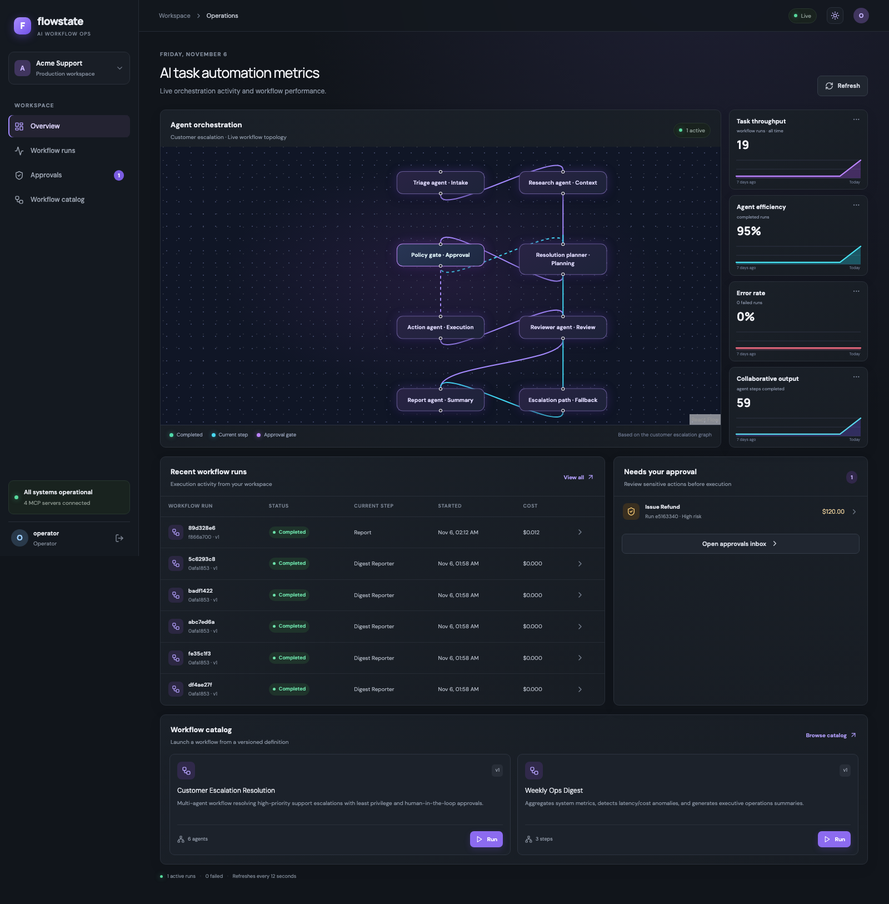
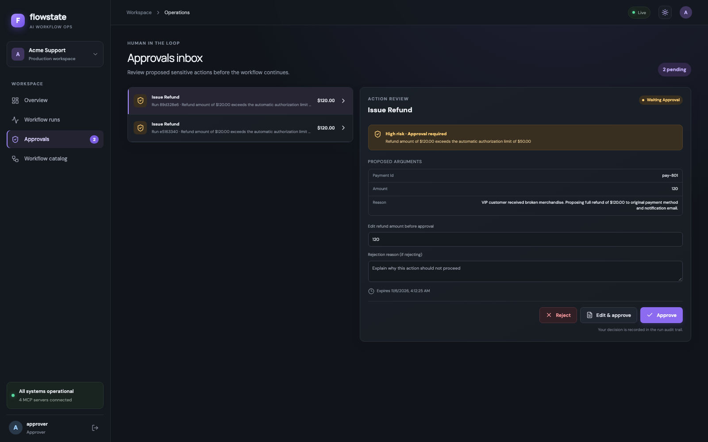
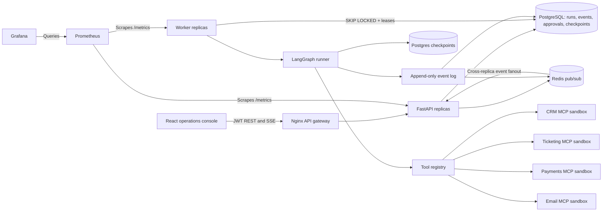

# Flowstate — Multi-Agent AI Workflow Platform

[GitHub repository](https://github.com/MazenElharmeel-spec/flowstate-multi-agent-workflow-platform)

[](https://render.com/deploy?repo=https://github.com/MazenElharmeel-spec/flowstate-multi-agent-workflow-platform)

Flowstate is a demo platform for durable, auditable AI workflows. It combines **FastAPI**, **LangGraph**, **PostgreSQL**, **Redis**, MCP sandbox tools, and a responsive React operations console. It demonstrates human approval gates, checkpointed execution, retry, idempotent actions, horizontal API/worker scaling, and workflow observability.

The default scripted model makes the demo deterministic and requires no paid model API key. The included CRM, ticketing, payment, and email services are local synthetic sandboxes; this is not a production refund system.

## Screenshots

| Operations overview | Approval review |
| --- | --- |
|  |  |

The screenshots use seeded synthetic data. They show the local demo UI, not a hosted service.

The [Render Blueprint](render.yaml) bundles the web app, workflow worker, and sandbox MCP tools into one small demo service, with managed PostgreSQL and Redis. The free web service sleeps after 15 minutes without traffic and can take about a minute to wake. The free PostgreSQL database expires after 30 days; upgrade or migrate it before then if you want to keep the demo running. The hosted seed omits the admin account; operator and approver demo accounts remain available. Hosted deployment setup and limitations are documented here so this demo does not imply production readiness.

## Run the demo

### Requirements

- Docker Engine with Docker Compose v2
- Enough Docker resources to run the API, workers, database, cache, frontend, and sandbox services
- Ports `3010`, `3031`, `5433`, `6380`, `8100`, and `9091` available

### Start

```bash
git clone https://github.com/MazenElharmeel-spec/flowstate-multi-agent-workflow-platform.git
cd flowstate-multi-agent-workflow-platform
cp .env.example .env
docker compose up --build -d
```

Open the console at [http://localhost:3010](http://localhost:3010). Sign in with one of the local demo accounts:

| Role | Email | Password |
| --- | --- | --- |
| Operator | `operator@example.com` | `OperatorSecret123!` |
| Approver | `approver@example.com` | `ApproverSecret123!` |
| Admin (local demo only) | `admin@example.com` | `AdminSecret123!` |

These credentials are intentionally public demo credentials. Use them only with the local sandbox.

### Try a human-approved workflow

1. Sign in as the operator and open **Workflow catalog**.
2. Start **Customer Escalation Resolution**. The seeded scenario proposes a refund above the approval threshold.
3. Open **Approvals** as the approver. Approve, reject, or edit the proposed refund amount.
4. Return to the run details to inspect its graph, event history, checkpoints, and result.

The **Weekly Ops Digest** workflow is a shorter run for exploring queueing and run telemetry. Example request payloads and the synthetic fixture summary are in [`examples/`](examples/).

### Stop

```bash
docker compose down
```

This stops containers and preserves demo database volumes. No public hosted demo is currently deployed; the Compose stack is the runnable demo.

## Architecture



Workers claim queued rows with PostgreSQL `FOR UPDATE SKIP LOCKED`, set an owner and renewable lease, and recover expired leases while polling. LangGraph checkpoints runs in PostgreSQL. Approval decisions are persisted before resumption. Redis distributes live events to SSE subscribers connected to any API replica; the database event log remains the source of truth.

Scale the API and worker tiers independently:

```bash
docker compose up --build -d --scale api=2 --scale worker=3
```

The API gateway stays at [http://localhost:8100](http://localhost:8100), and the console stays at [http://localhost:3010](http://localhost:3010). Prometheus discovers replicas through Docker DNS. Each worker runs up to five workflows concurrently by default; tune `WORKER_MAX_CONCURRENCY`, `DB_POOL_SIZE`, and `DB_MAX_OVERFLOW` to fit your PostgreSQL connection budget.

The overview and agent graph adapt to smaller screens; the graph reflows into two-column and single-column layouts.

## API documentation

- Interactive Swagger UI: [http://localhost:8100/docs](http://localhost:8100/docs)
- OpenAPI JSON: [http://localhost:8100/openapi.json](http://localhost:8100/openapi.json)
- Concise route/authentication reference: [`docs/api-reference.md`](docs/api-reference.md)

Protected endpoints use `Authorization: Bearer <access_token>`. The API includes authentication, workflow definitions, run lifecycle/history/SSE, approvals, tool metadata, health, and Prometheus metrics.

## Development and tests

Backend setup and checks:

```bash
uv sync --extra dev
make test
make lint
make typecheck
```

Frontend setup and build:

```bash
cd frontend
npm ci
npm run build
npm run typecheck
```

The backend suite includes unit and integration tests for authentication and role permissions, approval/edit/reject flows, tool idempotency, MCP discovery/failures, and malicious ticket content. CI runs backend tests and static checks, the frontend build/typecheck, and a Compose readiness smoke check.

## Example data and safety

All bundled customer, ticket, payment, and order records are synthetic fixtures. They use reserved `example.com` email addresses and contain no imported customer data. See [`examples/synthetic-support-scenarios.json`](examples/synthetic-support-scenarios.json) and [`examples/README.md`](examples/README.md).

Refund proposals above `$50` pause for human approval. Edited arguments are schema-validated and rechecked by policy. Payment and email writes require idempotency keys persisted by their sandbox MCP servers. Run events pass through secret/PII redaction before storage and streaming.

## Evaluation

[`docs/eval-report.md`](docs/eval-report.md) records the deterministic scripted benchmark, including its scope and limitations. It is a regression check for this seeded demo, not a broad model-quality or production safety evaluation. Set `DEFAULT_LLM_PROVIDER=anthropic` and provide `ANTHROPIC_API_KEY` in `.env` only if you want to try a real model provider.

## CV project description

The truthful project summary and resume bullets are in [`docs/cv-project-description.md`](docs/cv-project-description.md). This repository does **not** implement the proposed pgvector RAG assistant: it has no document ingestion pipeline, vector database, source citations, or retrieval evaluation. Do not describe it as that system.

## Limitations

- Workflow graphs are built in code by workflow key; stored user-authored graph JSON is not dynamically compiled.
- PostgreSQL is the durable queue and checkpoint store. Horizontal capacity depends on PostgreSQL, Redis, LLM-provider, and MCP sandbox limits.
- The bundled MCP tools use deterministic local fixtures; production use requires real providers and scoped credentials.
- Approval expiry is checked when a decision is submitted but is not automatically scheduled.
- Checkpoint history is visible, but arbitrary time-travel replay controls are not implemented.
- The OpenTelemetry Collector currently uses a debug exporter. Configure a production exporter and secure the observability endpoints before deployment.
- The local demo credentials are intentionally public. Replace secrets, configure TLS, restrict CORS, and add tenant isolation before exposing any deployment.
