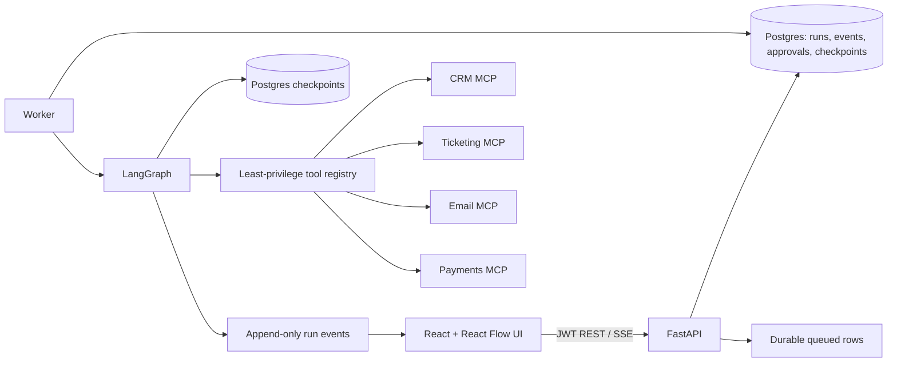

# Flowstate — Multi-Agent AI Workflow Platform

A production-minded demo platform for durable, auditable AI workflows. It uses FastAPI, SQLAlchemy, LangGraph, a separate worker, MCP sandbox services, and a React operations console. The default scripted LLM mode runs without an API key.

## 5-minute demo

Requirements: Docker Compose v2, Node/npm (for local frontend development), and Python 3.12 (for local checks). The containerized demo does not need an Anthropic key.

```bash
cp .env.example .env
make up
```

Compose starts Postgres, Redis, four MCP sandbox servers, the API, worker, and web console. The API applies Alembic migrations and seeds demo users and versioned workflows. Open [http://localhost:3010](http://localhost:3010), then sign in:

- Operator: `operator@example.com` / `OperatorSecret123!`
- Approver: `approver@example.com` / `ApproverSecret123!`
- Admin: `admin@example.com` / `AdminSecret123!`

Create a Customer Escalation run from the catalog. The scripted scenario classifies a damaged product, gathers CRM/ticket/payment/KB context, proposes a $120 refund, then pauses because refunds above $50 require approval. Sign in as the approver, edit the amount if desired, and approve or reject. The worker resumes the saved graph checkpoint. The payment and email sandboxes persist idempotency keys in SQLite volumes, so replaying an action returns its original result.

Weekly Ops Digest is included as a second workflow. API docs are at [http://localhost:8100/docs](http://localhost:8100/docs); readiness is at Readiness is at [http://localhost:8100/readyz](http://localhost:8100/readyz) and Prometheus metrics are at `/metrics`.

## Architecture



The worker claims queued records atomically from Postgres. On restart, stale `running` rows are re-queued, and LangGraph resumes from the most recent checkpoint. Approval decisions are persisted before the run is queued again. See [architecture documentation](docs/architecture.md) and [ADRs](docs/adr/).

## Security and failure handling

JWT-protected API routes enforce role permissions. Registration and workflow definition creation require an administrator; run creation/cancellation requires an operator; approval decisions require an approver. Refunds above $50 pause at a graph interrupt. Edited arguments are schema-validated and checked by policy again. Tool outputs are size-limited and explicitly wrapped as untrusted context. Run event payloads pass through recursive secret/PII redaction.

MCP calls have timeouts, bounded retries, and transient/permanent error classes. Refund and email writes require idempotency keys, which are persisted by the sandbox services. The worker re-queues in-flight runs after restart; the database checkpoints preserve graph progress. The test suite covers approval, edit/reject, tool idempotency, MCP failure, and malicious ticket text.

## Local development

```bash
uv sync --extra dev
make migrate
make seed
make test
make lint
make typecheck
make web-build
```

For a local Vite frontend, run `cd frontend && npm install && npm run dev`; set `VITE_API_URL=http://localhost:8100/api/v1` if using the API outside Compose. The browser login uses the demo users seeded above.

To use Anthropic, set `DEFAULT_LLM_PROVIDER=anthropic` and `ANTHROPIC_API_KEY` in `.env`. The scripted fake provider is the default and keeps the demo deterministic.

## Observability

- JSON logs include timestamps and redact common secrets and card numbers.
- `/metrics` exposes the Prometheus client endpoint.
- Every run has a persisted ordered event timeline and a trace ID field.
- SSE streams authenticated run events to the UI.

## Evaluation

`make eval` runs 25 scripted customer escalation variants and writes [`docs/eval-report.md`](docs/eval-report.md). Set the provider to Anthropic to exercise a real model. The report labels the deterministic scripted benchmark scope; it is not a substitute for a broader quality and safety evaluation.

## Known limitations and next steps

The reference workflows are code-built by workflow key; arbitrary user-authored graph JSON is stored but not compiled. Redis is provisioned but the current durable queue and SSE event history use Postgres plus in-process fanout; multi-replica API deployments need shared Redis pub/sub and queue leases. Approval expiry is enforced when a decision is submitted but not yet auto-scheduled. The UI exposes checkpoint history but not arbitrary time-travel replay controls. OpenTelemetry SDK packages are present, but distributed trace export and Grafana dashboards still need wiring. The MCP fakes are sandbox tools; production deployments need scoped credentials and external provider adapters.
