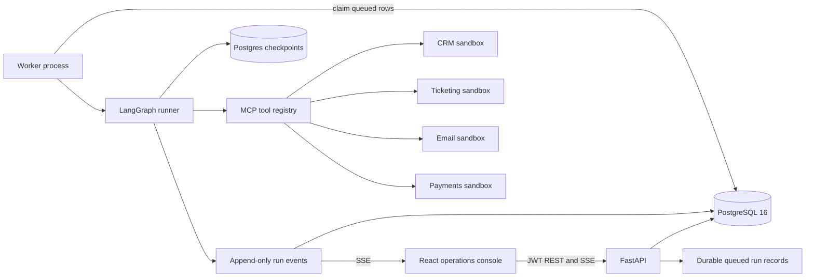

# Architecture

## Runtime flow



The API creates a version-pinned run after validating its JSON input schema. The worker claims queued rows with an atomic status update. LangGraph writes checkpoints to Postgres; approval decisions change the corresponding run back to `queued`, and the worker reconstructs the resume command from the durable approval row. On worker startup, stale `running` rows are requeued. Every payment write uses a stable idempotency key derived from run and action identifiers.

## Approval sequence

```mermaid
sequenceDiagram
  participant W as Worker
  participant G as LangGraph
  participant P as Policy engine
  participant DB as Postgres
  participant U as Approver UI
  W->>G: execute run
  G->>P: evaluate proposed refund
  P-->>G: approval required above $50
  G->>DB: persist approval + checkpoint
  G-->>W: interrupt
  U->>DB: approve / reject / edit
  DB->>DB: audit decision; enqueue run
  W->>G: resume from checkpoint + decision
  G->>G: validate edited args; execute idempotent action
```

## State and data model

`WorkflowState` is the LangGraph typed state: run identity and inputs, per-agent outputs, tool records, approval decision, retries/budgets, token/cost totals, and errors. SQLAlchemy tables hold users, versioned definitions, runs, append-only events, approvals, audit records, and serialized checkpoint records.

## API surface

- `/api/v1/auth`: login, current user, administrator-only user registration
- `/api/v1/workflows`: list and inspect versioned definitions; administrator registration
- `/api/v1/runs`: enqueue/list/read/cancel runs, event history, checkpoint history, authenticated SSE
- `/api/v1/approvals`: approval inbox, details, and approve/reject/edit decisions
- `/api/v1/tools`: discovered tool schemas and risk metadata
- `/healthz`, `/readyz`, `/metrics`: liveness, dependency readiness, and Prometheus scrape

## Event taxonomy

Run events include `run.queued`, `run.started`, `run.waiting_approval`, `run.completed`, `run.failed`, and `run.cancelled`; node events include `node.started` and `node.finished`; action events include `tool.call`, `policy.evaluated`, `approval.requested`, and `approval.resolved`. Event payloads pass through recursive redaction before persistence and streaming.

## Operational choices and current boundaries

Arq was selected as a possible queue library in dependencies, but the current worker uses PostgreSQL as the durable queue and an atomic compare-and-set claim. This keeps the demo's run record and queue state in one transaction boundary. Redis is included in Compose for future pub/sub, rate limiting, and distributed coordination; current SSE fanout is in-process, so multiple API replicas need a shared Redis event channel before horizontal scaling.

The shipped graph builders are versioned by workflow key and currently contain two executable definitions. User-created graph JSON is stored and versioned, but arbitrary graph JSON is not dynamically compiled. MCP sandboxes use deterministic local fixture data. The fake LLM is the default; set an Anthropic key and provider setting to use the remote model. Full time-travel replay controls, automatic approval expiry scheduling, per-user tenant isolation, and a Grafana dashboard are follow-up work; checkpoint history and the core approval/resume path are available.
