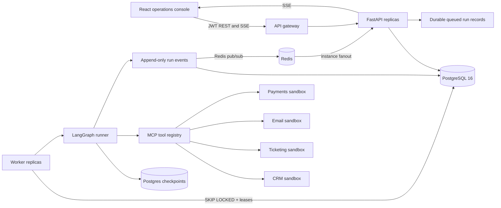

# Architecture

## Runtime flow



The API creates a version-pinned run after validating its JSON input schema. Workers claim queued rows in a transaction with `FOR UPDATE SKIP LOCKED`, set an owner and lease expiry, and renew the lease while executing. If a worker exits, another worker requeues the row after its lease expires. LangGraph writes checkpoints to Postgres; approval decisions clear the old lease, return the run to `queued`, and are used to reconstruct the resume command. Every payment write uses a stable idempotency key derived from run and action identifiers.

## Approval sequence

```mermaid
sequenceDiagram
  participant W as Worker
  participant G as LangGraph
  participant P as Policy engine
  participant DB as Postgres
  participant U as Approver UI
  W->>G: execute run
  G->>P: evaluate proposed refund
  P-->>G: approval required above $50
  G->>DB: persist approval + checkpoint
  G-->>W: interrupt
  U->>DB: approve / reject / edit
  DB->>DB: audit decision; enqueue run
  W->>G: resume from checkpoint + decision
  G->>G: validate edited args; execute idempotent action
```

## State and data model

`WorkflowState` is the LangGraph typed state: run identity and inputs, per-agent outputs, tool records, approval decision, retries/budgets, token/cost totals, and errors. SQLAlchemy tables hold users, versioned definitions, runs, append-only events, approvals, audit records, and serialized checkpoint records.

## API surface

- `/api/v1/auth`: login, current user, administrator-only user registration
- `/api/v1/workflows`: list and inspect versioned definitions; administrator registration
- `/api/v1/runs`: enqueue/list/read/cancel runs, event history, checkpoint history, authenticated SSE
- `/api/v1/approvals`: approval inbox, details, and approve/reject/edit decisions
- `/api/v1/tools`: discovered tool schemas and risk metadata
- `/healthz`, `/readyz`, `/metrics`: liveness, dependency readiness, and Prometheus scrape

## Event taxonomy

Run events include `run.queued`, `run.started`, `run.waiting_approval`, `run.completed`, `run.failed`, and `run.cancelled`; node events include `node.started` and `node.finished`; action events include `tool.call`, `policy.evaluated`, `approval.requested`, and `approval.resolved`. Event payloads pass through recursive redaction before persistence and streaming.

## Horizontal scaling

Compose separates schema/seed initialization from API startup, so scaled API replicas do not race through migrations. The Nginx gateway resolves API replicas through Docker DNS. Run `docker compose up -d --scale api=2 --scale worker=3` to add replicas. Prometheus discovers all API and worker replicas. Redis pub/sub distributes events to SSE subscribers on all API replicas; the append-only Postgres event log remains authoritative, and SSE reads new rows from it to recover from missed or out-of-order pub/sub notifications. Configure database pool limits to fit the PostgreSQL connection budget before increasing replica counts.

## Current boundaries

The shipped graph builders are versioned by workflow key and currently contain two executable definitions. User-created graph JSON is stored and versioned, but arbitrary graph JSON is not dynamically compiled. MCP sandboxes use deterministic local fixture data. The fake LLM is the default; set an Anthropic key and provider setting to use the remote model. Full time-travel replay controls, automatic approval expiry scheduling, and per-user tenant isolation remain follow-up work; checkpoint history and the core approval/resume path are available.
