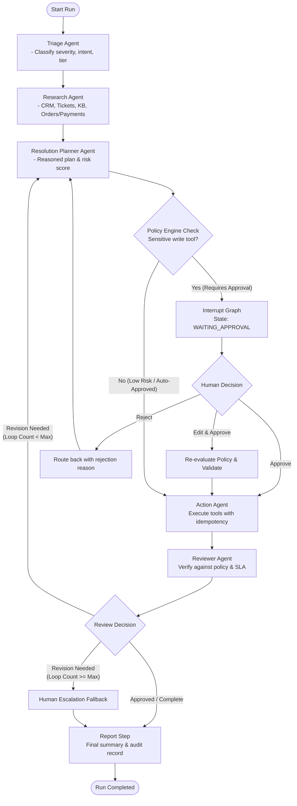
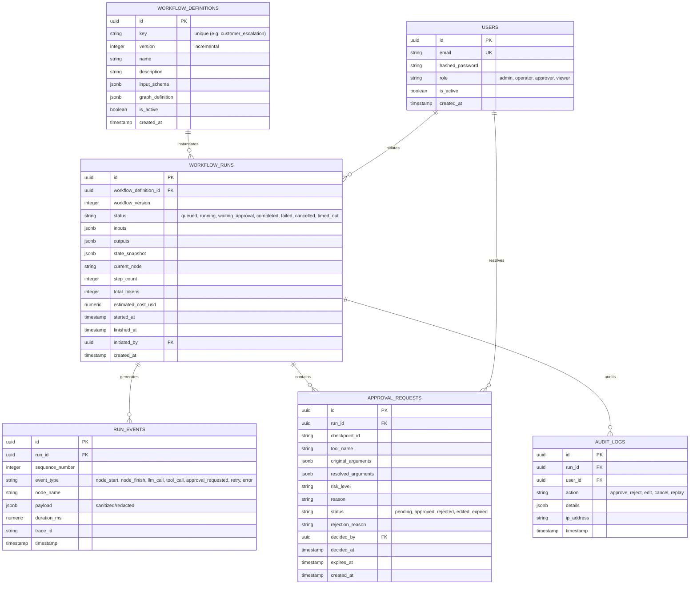

# Architecture & Specification: Multi-Agent AI Workflow Platform

## 1. Graph Workflow Architecture (Mermaid)

### Reference Workflow: Customer Escalation Resolution



---

## 2. State Schema (`WorkflowState`)

```python
class AgentOutput(BaseModel):
    agent_name: str
    thought_process: str
    output_data: dict[str, Any]
    tokens_used: int = 0
    duration_ms: float = 0.0

class ToolCallRecord(BaseModel):
    call_id: str
    tool_name: str
    arguments: dict[str, Any]
    idempotency_key: str
    status: Literal["pending", "approved", "rejected", "executed", "failed"]
    result: Any | None = None
    error: str | None = None
    duration_ms: float = 0.0

class ApprovalRequestState(BaseModel):
    approval_id: str
    tool_name: str
    arguments: dict[str, Any]
    reasoning: str
    risk_level: Literal["low", "medium", "high"]
    diff_summary: str
    status: Literal["pending", "approved", "rejected", "edited"]
    created_at: datetime
    expires_at: datetime

class EscalationState(TypedDict, total=False):
    # Core identifiers
    run_id: str
    workflow_id: str
    workflow_version: int
    customer_id: str
    ticket_id: str
    
    # Inputs
    initial_input: dict[str, Any]
    
    # Agent deliverables
    triage_result: dict[str, Any]
    research_context: dict[str, Any]
    proposed_plan: dict[str, Any]
    action_results: list[dict[str, Any]]
    review_result: dict[str, Any]
    final_report: dict[str, Any]
    
    # Execution Tracking
    current_agent: str
    tool_calls: list[ToolCallRecord]
    approvals: list[ApprovalRequestState]
    active_approval_id: str | None
    
    # Budget & Bounded Loop Counters
    step_count: int
    tool_call_count: int
    total_tokens: int
    estimated_cost_usd: float
    planner_reviewer_loops: int
    max_loops: int
    
    # Error & Recovery
    errors: list[dict[str, Any]]
    fallback_escalated: bool
```

---

## 3. Data Model ERD (PostgreSQL)



---

## 4. API Surface

| Method | Endpoint | Description | Auth Roles |
|---|---|---|---|
| `POST` | `/api/v1/auth/login` | Issue JWT access & refresh tokens | Public |
| `GET` | `/api/v1/auth/me` | Current user profile & roles | Any |
| `GET` | `/api/v1/workflows` | List workflow definitions & active versions | Viewer+ |
| `POST` | `/api/v1/workflows` | Register/update a workflow definition | Admin |
| `POST` | `/api/v1/runs` | Trigger a new workflow run | Operator+ |
| `GET` | `/api/v1/runs` | List runs with filters (status, workflow) | Viewer+ |
| `GET` | `/api/v1/runs/{id}` | Run details, state snapshot, cost & metrics | Viewer+ |
| `GET` | `/api/v1/runs/{id}/stream` | Server-Sent Events (SSE) live updates | Viewer+ |
| `POST` | `/api/v1/runs/{id}/cancel` | Cancel an active run | Operator+ |
| `POST` | `/api/v1/runs/{id}/replay` | Replay execution from a checkpoint | Operator+ |
| `GET` | `/api/v1/approvals` | List pending/historical approvals | Approver+ |
| `POST` | `/api/v1/approvals/{id}/decide` | Approve, reject, or edit arguments | Approver |
| `GET` | `/api/v1/tools` | Registry catalog with risk levels & MCP status | Viewer+ |
| `GET` | `/healthz` | Liveness and readiness (DB, Redis, MCPs) | Public |
| `GET` | `/metrics` | Prometheus metrics export | Internal/Public |

---

## 5. Event Taxonomy

| Event Type | Source | Payload Highlights |
|---|---|---|
| `run.queued` | Worker / API | `run_id`, `workflow_key`, `inputs` |
| `run.started` | Orchestrator | `run_id`, `checkpoint_id`, `start_time` |
| `node.started` | LangGraph Node | `node_name`, `step_index`, `input_summary` |
| `node.finished`| LangGraph Node | `node_name`, `step_index`, `output_summary`, `duration_ms` |
| `llm.call` | LLM Gateway | `model`, `prompt_hash`, `tokens_in`, `tokens_out`, `cost_usd`, `latency_ms` |
| `tool.call` | Tool Registry | `tool_name`, `args` (redacted), `idempotency_key`, `side_effect`, `risk` |
| `tool.result` | Tool Registry | `tool_name`, `status`, `duration_ms`, `sanitized_result` |
| `policy.evaluated`| Policy Engine| `tool_name`, `requires_approval`, `matched_rules` |
| `approval.requested`| Interrupt Node| `approval_id`, `tool_name`, `diff`, `expires_at` |
| `approval.resolved`| Approval Svc | `approval_id`, `decision`, `decided_by`, `edited_args` |
| `run.completed`| Orchestrator | `final_status`, `total_steps`, `total_tokens`, `cost_usd` |
| `run.failed` | Error Handler | `error_type` (transient/perm/model), `message`, `stack_trace` |

---

## 6. Vertical Phases Breakdown

1. **Phase 1: Foundation & Scaffold**
   - Project directory layout, `pyproject.toml`, Docker Compose (PostgreSQL 16, Redis, Otel, Grafana).
   - Core config (Pydantic settings), security (JWT, RBAC), DB engine (SQLAlchemy async + asyncpg), Alembic migrations, healthcheck.
2. **Phase 2: Tool Registry, MCP Client & 4 Local MCP Servers**
   - Tool abstraction with risk, side-effects, idempotency keys, input validation.
   - 4 local MCP servers: `crm-mcp`, `ticketing-mcp`, `email-mcp`, `payments-mcp` (backed by SQLite/in-memory data with deterministic seed records).
   - MCP client with discovery, timeout, reconnect backoff, and mock/live tests.
3. **Phase 3: LangGraph Engine, State, Checkpointing & Worker**
   - State definitions, Postgres checkpointing adapter, graph lifecycle.
   - Redis-backed background worker with concurrency and crash resilience.
   - Append-only `run_events` DB logger and SSE streaming event broadcaster.
4. **Phase 4: Specialized Agents & Workflows (Reference + Second Workflow)**
   - Agents: Triage, Research, Resolution Planner, Action Agent, Reviewer Agent, Report step.
   - Provider-agnostic LLM interface + deterministic Scripted Fake LLM (exercises happy path, approval, rejection, and errors).
   - Bounded reviewer loop, budgets (token, step, cost, timeout), error taxonomy.
   - Second workflow: Weekly Ops Digest.
5. **Phase 5: Policy Engine, Approvals & Idempotent Safety**
   - Declarative policy rules (amount threshold > $50, customer tiers, risky actions).
   - Human-in-the-loop `interrupt()` and resume flow (approve, reject with replan, edit arguments).
   - Idempotency key verification ensuring no duplicate payments or emails across retries and restarts.
6. **Phase 6: Frontend Application**
   - React 18 + TypeScript (strict) + Vite + Tailwind + shadcn/ui.
   - Workflow Catalog & Launch Form, Runs List & Detail with React Flow graph execution visualizer, Live SSE timeline, Approvals Inbox with edit/approve modal, Admin & Metrics views.
7. **Phase 7: Observability, Evals, CI, Documentation & Verification**
   - OpenTelemetry traces & Prometheus metrics.
   - Eval harness (`make eval`) testing 25 escalation cases.
   - ADRs in `docs/adr/`, architecture documentation, complete Makefile (`make up`, `make seed`, `make test`, `make demo`).
   - End-to-end demo script and verification.
